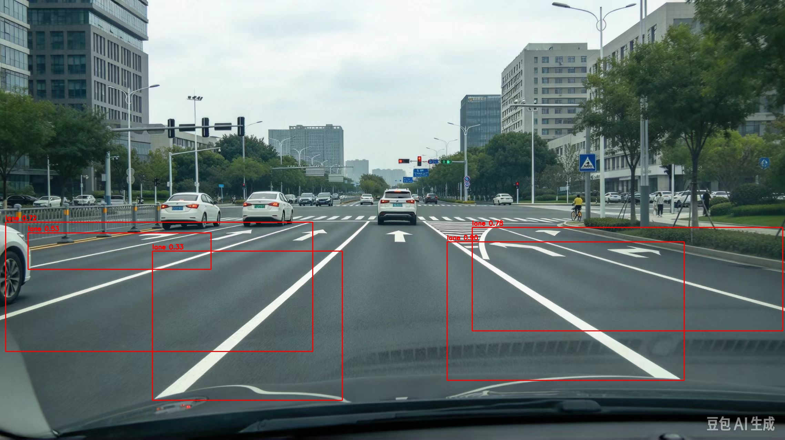

# 车道线检测模型 C++ 部署

自训练的 YOLOv8n 车道线模型，在 Linux 上用 C++ 部署，对比 ONNX Runtime 和 OpenVINO 两个推理引擎。

## 效果



## 实测性能

环境：WSL2 Ubuntu，Intel i5-12500H，输入 640×640。
测试用 20 秒视频，跳过前 30 帧预热，统计 500 帧取平均。

| 引擎 | 模型 | 纯处理耗时 | 帧率 | NMS 后框数 |
|---|---|---|---|---|
| ONNX Runtime | FP32 | 39.42 ms | 25.37 FPS | 7.77 |
| OpenVINO | FP32 | 41.44 ms | 24.13 FPS | 7.77 |
| ONNX Runtime | INT8 | 60.42 ms | 16.55 FPS | 7.13 |
| OpenVINO | INT8 | 27.37 ms | 36.54 FPS | 7.21 |

几点读数：

FP32 下两个引擎速度相当，输出框数完全一致。

INT8 下差距很大。ONNX Runtime 比自己的 FP32 慢 35%，OpenVINO 比自己的 FP32 快 51%，两者相差 2.2 倍。

量化后 NMS 框数从 7.77 降到 7.13，精度损失约 8%。

原因是 ONNX Runtime 在 CPU 上的 INT8 路径不成熟，部分算子退回浮点计算，加上量化与反量化的开销，反而拖慢。OpenVINO 用上了 Intel CPU 的 AVX-VNNI 指令，所以能真正加速。

## 怎么跑

需要 OpenCV、ONNX Runtime 1.31.0、OpenVINO。

```bash
cmake . && make

./lane_fps_ort     # ONNX Runtime 版，跑视频测帧率
./lane_fps_ov      # OpenVINO 版，同上
./lane_ort         # ONNX Runtime 版，单图检测
./lane_ov          # OpenVINO 版，同上
```

模型和视频按下面的路径放好。跑视频时按 Q 或 Esc 退出。

## 文件说明

| 路径 | 内容 |
|---|---|
| src/lane_fps_test_ort.cpp | ONNX Runtime 版，跑视频统计帧率和框数 |
| src/lane_fps_test_ov.cpp | OpenVINO 版，同上 |
| src/lane_ort.cpp | ONNX Runtime 版，单图检测并存结果图 |
| src/lane_ov.cpp | OpenVINO 版，同上 |
| models/lane_model.onnx | 原始模型，FP32 |
| models/lane_ort_int8.onnx | ONNX Runtime 量化版 |
| models/lane_ov_int8.xml | OpenVINO 量化版，需要同目录的 .bin 文件 |
| data/lane_test.mp4 | 测试视频 |
| data/lane_test.jpg | 测试图片 |
| tools/export_for_ort.py | 从 .pt 导出 ONNX 并做量化 |
| tools/quant_for_ov.py | 用 NNCF 把 ONNX 量化成 OpenVINO 格式 |
| CMakeLists.txt | 编译配置 |

## 模型来源

自采的 94 张行车记录仪视角车道线图片，用 yolov8n 迁移学习训练，50 轮，单类。导出 ONNX 时 imgsz 必须和训练一致，都是 640。
（由于工作量原因暂未添加更多不同环境的图片，如雨天，阴天等）
